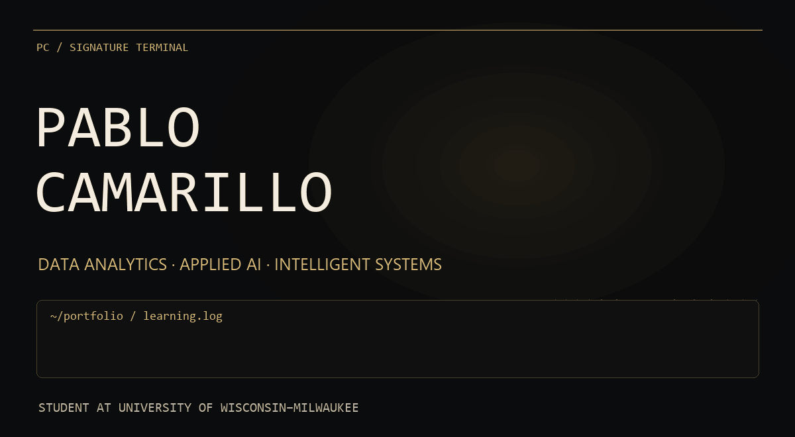
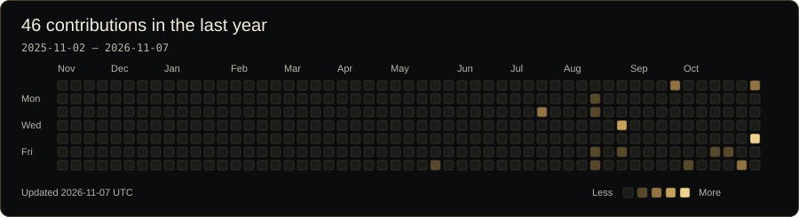
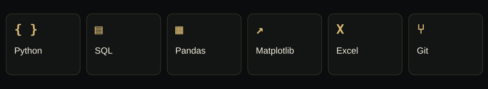
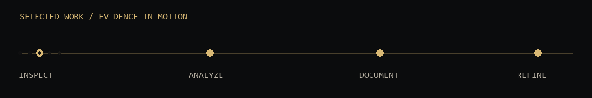
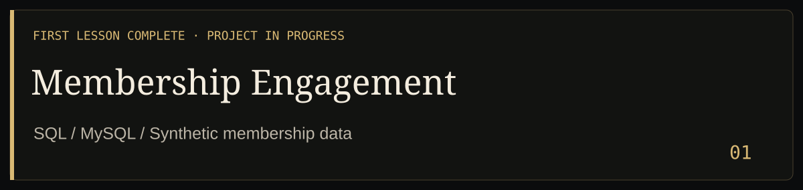
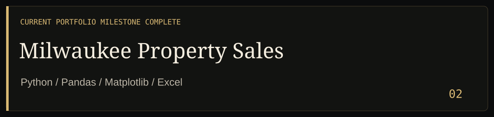

## GitHub contribution activity

<picture>
  <source media="(max-width: 600px)" srcset="assets/contributions-mobile.svg">
  
</picture>

A custom gold rendering of my **publicly visible GitHub contribution calendar**. The date range and last refresh appear in the graphic. This is activity context, not a proficiency or productivity score; GitHub’s native graph remains the authoritative view.

[Live GitHub profile](https://github.com/pablocamarillo?tab=overview) · [Daily snapshot data](data/contributions.json) · [Frozen fallback snapshot](assets/contributions-fallback.svg)

# A signature built through deliberate practice

`~/portfolio $ whoami`

I’m **Pablo Camarillo**, pursuing a **B.S. in Data Analytics & Applied AI at the University of Wisconsin–Milwaukee**. I’m building practical skills through Python analysis, hands-on SQL learning, and work others can inspect.

**Seeking data analytics and data science internships, with a growing interest in AI engineering.**

[Prefer a still page? Read the static version.](README_STATIC.md)

**Technical focus:** Python · SQL · Excel · Pandas · Matplotlib · Data Analysis · Data Visualization.

## Selected work

**Building a relational foundation for membership analysis.** Created a MySQL database and subscription-plan table with a primary key, imported **three records**, and executed a SELECT query.

The project is **in development**. Remaining tables, imports, foreign-key relationships, and analytical reporting are next. Engagement insights and estimated-revenue analysis are planned; no business findings are claimed yet. The data is synthetic.

[Explore the project](https://github.com/pablocamarillo/membership-engagement-sql-analysis) · [First SELECT](https://github.com/pablocamarillo/membership-engagement-sql-analysis/blob/main/sql/01_fundamentals/01_select_subscription_plans.sql) · [Learning plan](https://github.com/pablocamarillo/membership-engagement-sql-analysis/blob/main/docs/project_plan.md)

**From yearly sales files to documented descriptive analysis.** Prepared and explored **53,607 cleaned records** from 2017–2025 source files using Python, Pandas, Matplotlib, and Excel. Published work includes data preparation, descriptive comparisons, chart-generating code, and an Excel audit.

The **current portfolio milestone is complete**. Final figure exports, source documentation, date anomalies, and neighborhood-label validation remain open. Findings describe recorded sales rather than the value of every property.

[Explore the project](https://github.com/pablocamarillo/milwaukee-property-sales-analysis) · [Analysis code](https://github.com/pablocamarillo/milwaukee-property-sales-analysis/blob/main/src/analyze_data.py) · [Methods and limitations](https://github.com/pablocamarillo/milwaukee-property-sales-analysis/blob/main/docs/analysis-notes.md)

---

## Education & direction

**University of Wisconsin–Milwaukee**  
**B.S. Data Analytics & Applied AI — In Progress**

**Practicing now:** Python/Pandas cleaning and descriptive analysis; Matplotlib chart code; Excel data review; SQL/MySQL creation, CSV import, and basic querying.

**Developing interests:** machine learning, AI engineering, local AI systems, and intelligent applications. These are learning directions—not claims of production experience.
